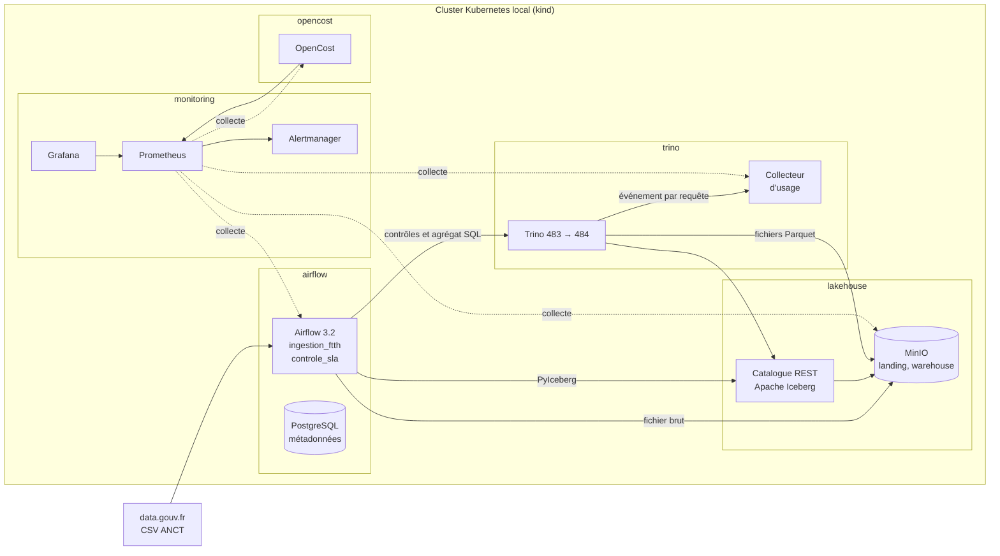
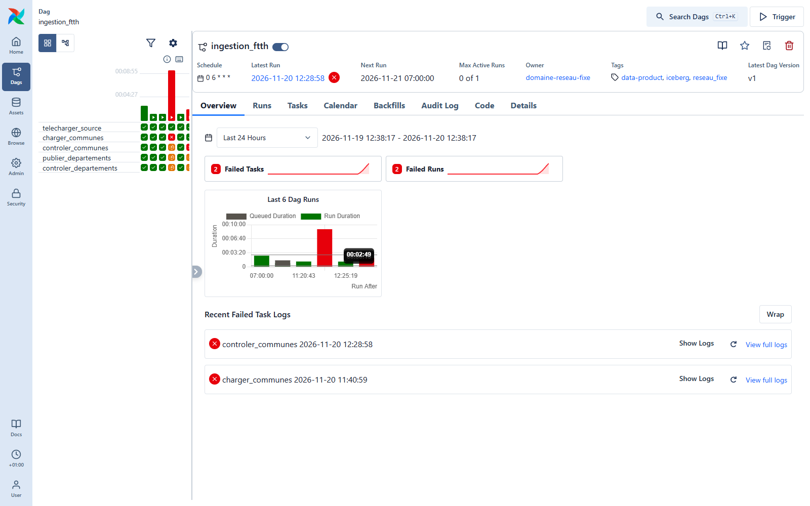
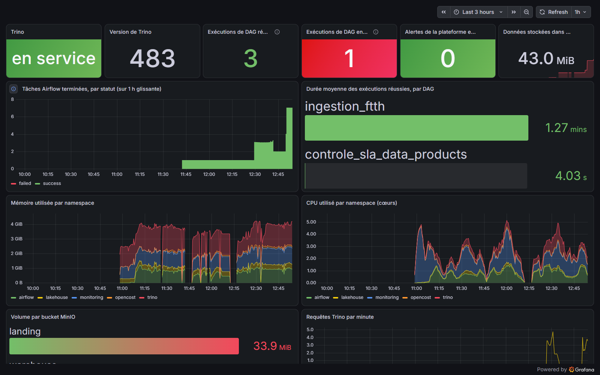
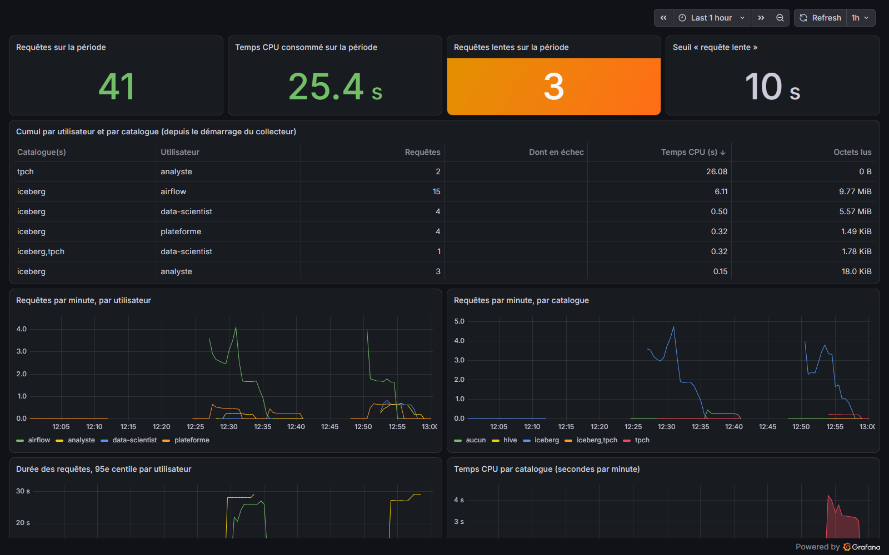
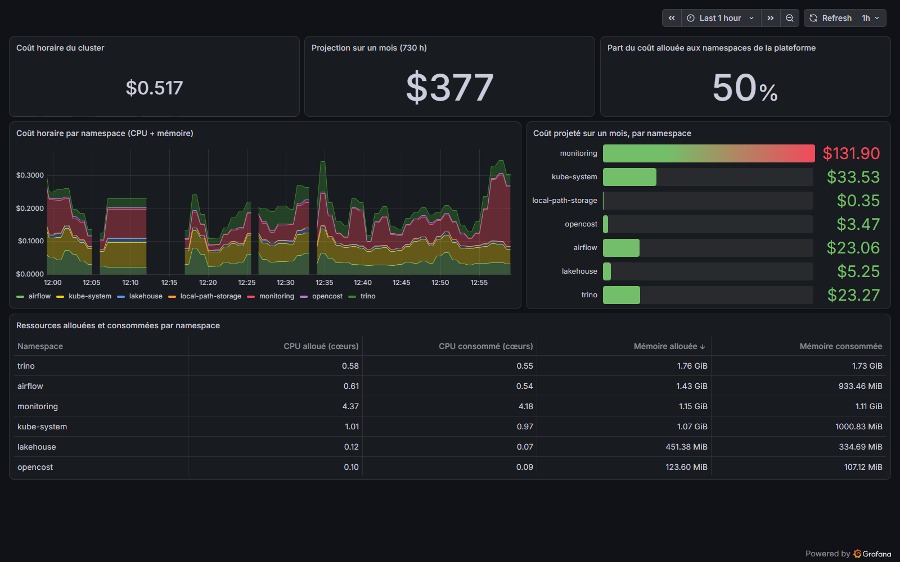
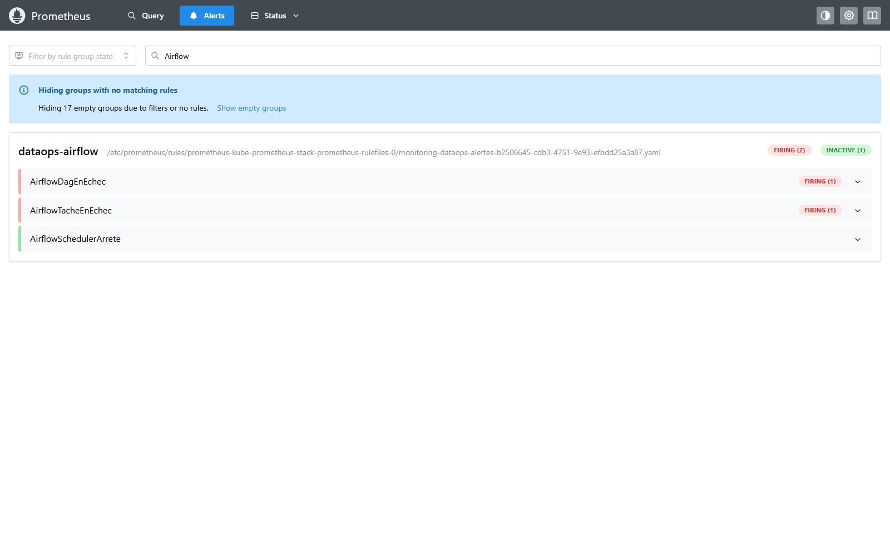
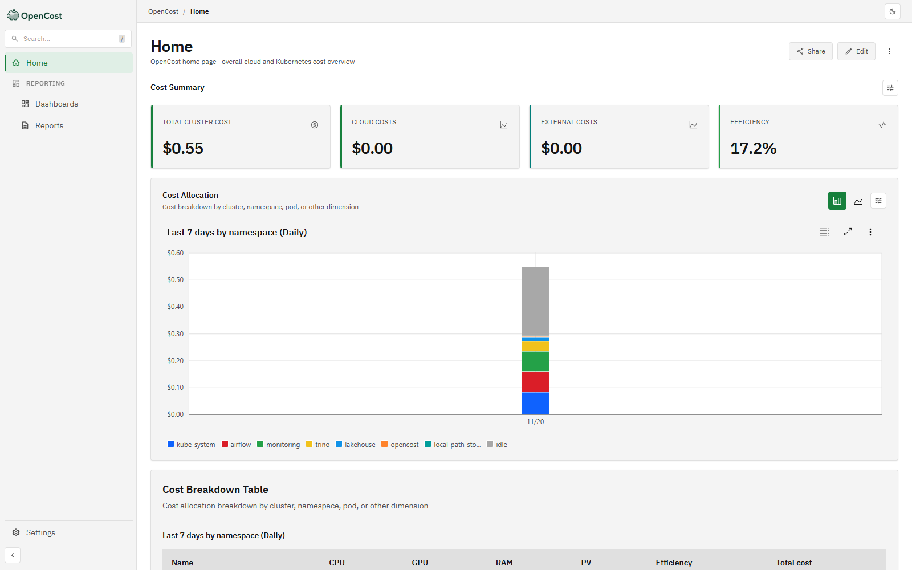
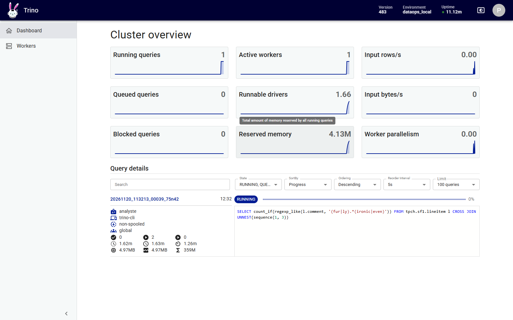

# Plateforme DataOps sur Kubernetes

[](https://github.com/Franckypro/dataops-k8s-platform/actions/workflows/ci.yml)

Une plateforme de données complète qui tourne sur un cluster Kubernetes local,
lancée en une commande et testée de bout en bout par la CI à chaque modification du code. Elle couvre les missions d'un
*Platform Engineer DataOps* : déploiement avec Helm, lakehouse Trino et Apache Iceberg, orchestration Airflow,
CI/CD, montée de version et retour arrière, supervision et alertes, suivi des usages et des coûts, data products.

Les données sont réelles : le déploiement de la fibre (FttH) et la fermeture programmée du réseau cuivre d'Orange,
commune par commune, publiés chaque trimestre par l'ANCT en open data.

## Ce que fait la plateforme

| Mission | Dans ce dépôt |
|---|---|
| Socle Kubernetes et Helm | Cluster kind épinglé (Kubernetes 1.37), 5 namespaces, 4 charts officiels configurés par `values/`, 4 charts écrits pour le projet (`charts/`) |
| Lakehouse | Trino 483 interroge des tables Apache Iceberg stockées dans MinIO, via un catalogue REST Iceberg |
| Orchestration | Airflow 3.2 (chart officiel) : téléchargement de la source, dépôt brut dans MinIO, chargement Iceberg avec PyIceberg, contrôles qualité, agrégat calculé par Trino |
| Data products | Un contrat YAML par table (propriétaire, schéma, niveau de service, contrôles qualité, accès), validé par la CI et appliqué par les DAG |
| CI/CD | GitHub Actions : lint, tests, contrats, `helm lint` et `helm template`, tests des DAG dans l'image, déploiement complet sur kind, test des alertes, montée de version et retour arrière |
| Montée de version | Trino 483 → 484 avec `helm upgrade`, vérifications de non-régression, `helm rollback` automatique en cas d'échec |
| Supervision | kube-prometheus-stack : 3 tableaux Grafana versionnés, 7 alertes (DAG en échec, requêtes lentes, Trino ou MinIO indisponible...) |
| Usages et FinOps | Collecteur des requêtes Trino par utilisateur et par catalogue ; coût par namespace avec OpenCost |

## Architecture



## Captures d'écran

Captures prises sur la plateforme lancée en local.

**Airflow** : le DAG `ingestion_ftth`, ses exécutions réussies et l'échec provoqué pour tester l'alerte.



**Grafana, vue d'ensemble** : Trino en service et sa version, exécutions Airflow, alertes en cours, ressources par namespace.



**Grafana, usages Trino** : requêtes, temps CPU et requêtes lentes, par utilisateur et par catalogue.



**Grafana, FinOps** : coût horaire, projection mensuelle et coût par namespace (tarifs indicatifs).



**Alertes** : un DAG en échec déclenche `AirflowDagEnEchec` et `AirflowTacheEnEchec` dans Prometheus, puis dans Alertmanager.



**OpenCost** : ventilation du coût du cluster par namespace.



**Trino** : la requête volontairement lente de l'utilisateur `analyste` lancée par le test d'alerte.



## Versions

| Brique | Version | Déployée avec |
|---|---|---|
| Kubernetes | 1.37 (kind 0.33) | `kind/cluster.yaml` |
| MinIO | RELEASE.2026-11-16 (image Chainguard) | `charts/lakehouse` |
| Catalogue REST Apache Iceberg | 1.10.1 | `charts/lakehouse` |
| Trino | 483, puis 484 | chart officiel `trino/trino` 1.44.0, puis 1.45.0 |
| Airflow | 3.2.2 | chart officiel `apache-airflow/airflow` 1.22.0 |
| PostgreSQL (métadonnées Airflow) | 17.7 | `charts/postgres` |
| PyIceberg | 0.12.0 | `images/airflow` |
| Prometheus, Alertmanager, Grafana 13 | kube-prometheus-stack 93.5.0 | chart officiel |
| OpenCost | 1.121.4 | chart officiel 2.5.34 |
| Collecteur d'usage Trino | Python, prometheus-client | `charts/trino-usage`, `images/trino-usage-exporter` |

## Lancer la plateforme

### Prérequis

- Docker Desktop (Windows ou macOS) ou Docker Engine (Linux), avec **au moins 6 Go de mémoire pour Docker**.
- [kind](https://kind.sigs.k8s.io/) 0.33, [Helm](https://helm.sh/) 4, kubectl, curl ; sous Windows, Git Bash (fourni avec Git for Windows).

Sous Windows :

```powershell
winget install --id Kubernetes.kind -e
```

```powershell
winget install --id Helm.Helm -e
```

> **Mémoire.** La plateforme complète occupe environ 5 à 6 Go dans Docker. Sur un PC de 16 Go, fermez les navigateurs
> et les applications lourdes pendant qu'elle tourne. Sinon, Windows met la mémoire de Docker sur disque et les
> composants Kubernetes ralentissent jusqu'à redémarrer (vécu pendant la construction du projet, voir plus bas).

### Une commande

```powershell
.\up.ps1
```

ou, depuis Git Bash, Linux ou macOS : `./scripts/up.sh`. Le même script est exécuté par la CI.

Il crée le cluster, construit les deux images (Airflow avec les DAG et les contrats, collecteur d'usage), génère les
mots de passe dans `.secrets/platform.env` (jamais versionné), installe les 8 releases Helm, attend le premier
chargement de données, puis lance les tests de fumée. Relancer la commande met à jour ce qui a changé.

| Interface | Adresse | Identifiants |
|---|---|---|
| Airflow | <http://localhost:30080> | `admin` / `AIRFLOW_ADMIN_PASSWORD` |
| Grafana | <http://localhost:30030> | `admin` / `GRAFANA_ADMIN_PASSWORD` (dossier « DataOps ») |
| Trino | <http://localhost:30088/ui> | n'importe quel nom d'utilisateur |
| Prometheus | <http://localhost:30090> | |
| Alertmanager | <http://localhost:30093> | |
| OpenCost | <http://localhost:30091> | |
| Console MinIO | <http://localhost:30901> | `MINIO_ROOT_USER` / `MINIO_ROOT_PASSWORD` |

Les mots de passe sont dans `.secrets/platform.env`. Pour tout supprimer : `.\down.ps1` (ou `./scripts/down.sh`).

## Parcours guidé

### 1. Les données arrivent

Le DAG `ingestion_ftth` (Airflow) télécharge chaque jour le CSV de l'ANCT (35 507 lignes au 2e trimestre 2026),
le dépose tel quel dans `s3://landing/ftth/`, puis le charge dans la table Iceberg `reseau_fixe.ftth_communes`.
La source ne publie que le dernier trimestre ; la table, partitionnée par trimestre, en garde l'historique.
Relancer le DAG remplace la partition du trimestre : aucun doublon.

```bash
./scripts/run-dag.sh ingestion_ftth
```

Les tables se lisent ensuite avec Trino, par exemple avec le petit client du dépôt
(`python scripts/trino_query.py --user analyste "SELECT ..."`) :

```sql
-- Départements où la fibre est la moins déployée
SELECT departement, round(100 * taux_raccordables_ftth, 1) AS pct_ftth
FROM iceberg.reseau_fixe.ftth_departements
ORDER BY taux_raccordables_ftth
LIMIT 5;

-- Historique de la table : chaque rechargement remplace la partition (un snapshot « delete » puis « append »)
SELECT committed_at, operation,
       element_at(summary, 'added-records') AS lignes_ajoutees,
       element_at(summary, 'deleted-records') AS lignes_supprimees
FROM iceberg.reseau_fixe."ftth_communes$snapshots"
ORDER BY committed_at;
```

### 2. Les data products et leurs contrats

Chaque table a son contrat dans `data-products/` : propriétaire, schéma, niveau de service, contrôles qualité.
Les tables sont créées à partir du contrat (les descriptions deviennent les commentaires des colonnes dans Trino),
les contrôles qualité en sont générés, et la CI refuse un contrat incomplet ou incohérent.
Détails : [docs/data-products.md](docs/data-products.md).

```sql
SELECT data_product, controle, lignes_en_echec, lignes_controlees, statut
FROM iceberg.plateforme.controles_qualite
ORDER BY date_controle DESC;
```

### 3. Les alertes

```bash
EXPECT_STATE=failed ./scripts/run-dag.sh ingestion_ftth '{"simuler_echec": true}'
```

Le DAG échoue sur un contrôle bloquant ajouté exprès ; l'alerte `AirflowDagEnEchec` apparaît dans Prometheus,
Alertmanager et Grafana. Une requête de plus de 10 secondes déclenche `TrinoRequetesLentes`.
Détails : [docs/supervision-et-couts.md](docs/supervision-et-couts.md).

### 4. Les usages et les coûts

Chaque requête Trino est comptée par utilisateur et par catalogue (requêtes, temps CPU, octets lus) dans le tableau
Grafana « Usages Trino ». OpenCost ventile le coût du cluster par namespace, avec des tarifs indicatifs.

```bash
python scripts/trino_query.py --user analyste "SELECT count(*) FROM tpch.sf1.orders"
python scripts/trino_query.py --user data-scientist "SELECT count(*) FROM iceberg.reseau_fixe.ftth_communes"
```

### 5. La montée de version de Trino

```bash
./scripts/trino-upgrade.sh     # 483 -> 484, vérifications, retour arrière automatique en cas d'échec
./scripts/trino-rollback.sh    # retour à la version précédente
```

Procédure complète et notes de version : [docs/montee-de-version-trino.md](docs/montee-de-version-trino.md).

## La CI

`.github/workflows/ci.yml`, à chaque modification du code :

1. **Lint, tests et contrats** : Ruff, ShellCheck, yamllint, validation des contrats, tests unitaires
   (contrats, contrôles qualité, collecteur d'usage).
2. **Charts Helm** : `helm lint` des charts du dépôt, `helm template` de tous les charts avec les valeurs du dépôt.
3. **DAG Airflow** : l'image Airflow est construite et les DAG y sont chargés et testés.
4. **Déploiement complet sur kind** : `./scripts/up.sh` (cluster, déploiement, premier chargement, tests de fumée),
   puis déclenchement réel des alertes, montée de version de Trino en 484 et retour arrière en 483.

Durées mesurées sur deux exécutions de la CI, sur une machine GitHub Actions vierge : lancement complet en
5 min 38 s à 6 min 55 s, test des alertes en 1 min 27 s à 2 min 08 s, montée de version de Trino en 29 à 43 s,
retour arrière en 14 à 23 s. Une modification qui ne touche que la documentation (`*.md`, `docs/`) ne relance pas
la CI.

## Choix techniques et limites

- **MinIO** ne publie plus d'image officielle depuis fin 2025 (Docker Hub répond 404, quay.io exige une
  authentification). L'image utilisée est reconstruite depuis les sources par Chainguard et épinglée par digest.
- **Catalogue Iceberg** : implémentation de référence du projet Apache Iceberg, avec un catalogue SQLite persistant.
  En production : Apache Polaris, Lakekeeper, Nessie, AWS Glue ou Unity Catalog.
- **Trino** tourne avec un seul coordinateur qui exécute aussi les requêtes. En production : des workers, de
  l'autoscaling et Trino Gateway pour monter de version sans coupure.
- **Airflow** utilise LocalExecutor et des DAG livrés dans l'image (étiquetée par l'empreinte de son contenu).
  En production : KubernetesExecutor ou CeleryExecutor, et des journaux centralisés.
- **Sécurité** : pas de TLS ni d'authentification sur Trino, et les moteurs utilisent l'identifiant principal de MinIO.
  Les mots de passe sont générés à l'installation et ne sont jamais versionnés. En production : OIDC, contrôle d'accès
  (OPA ou Ranger), une identité S3 par consommateur et un coffre-fort de secrets (Vault, External Secrets).
- **Coûts** : les prix d'OpenCost sont indicatifs (`values/opencost.yaml`).
- **Dataiku DSS** n'est pas intégré : la documentation de DSS 15 exige au moins 32 Go de RAM, soit le double de la
  machine de développement, et l'image Docker officielle est présentée comme réservée à l'évaluation.

## Problèmes rencontrés et solutions

| Problème | Cause | Solution |
|---|---|---|
| Image MinIO introuvable | MinIO a arrêté ses images publiques | Image Chainguard épinglée par digest |
| Base PostgreSQL du chart Airflow | Images Bitnami gratuites arrêtées en 2025 | Chart `postgres` avec l'image officielle |
| Requêtes Trino `USER_CANCELED` vues par le suivi d'usage | `TrinoHook.run()` ne lit pas le résultat : le client annule la requête en fermant le curseur, parfois après le commit | Toujours lire le résultat (`dataops.lakehouse.requete`) |
| Requêtes d'Airflow comptées sur un catalogue « hive » inexistant | Le hook Trino lit le catalogue dans les options de la connexion, pas dans le chemin de l'URI | Connexion `trino://airflow@...:8080/?catalog=iceberg` |
| Client `trino` tué (code 137) pendant une requête lourde | Lancé dans le pod de Trino, il partage la limite mémoire du serveur | Petit client Python de l'API HTTP de Trino (`scripts/trino_query.py`) |
| Connexion coupée juste après la montée de version (vue par la CI) | Mise à jour progressive : le NodePort envoyait encore la requête vers l'ancien pod en cours d'arrêt | Stratégie `Recreate` pour le coordinateur unique, réessais du client, attente de la version annoncée par Helm |
| Passage à `Recreate` refusé sur un cluster existant | Helm 4 applique côté serveur : le Deployment garde ses réglages `rollingUpdate` par défaut, interdits avec `Recreate` | Migration unique avec `kubectl patch` (retrait de `rollingUpdate`) ; `--rollback-on-failure` sur la montée de version |
| Tests de fumée en échec juste après l'installation (vu par la CI) | Prometheus met une à deux minutes à charger les nouveaux ServiceMonitor et règles | Vérifications relancées jusqu'à 5 minutes |
| Deux exécutions du DAG au premier démarrage | Airflow lance la dernière échéance manquée quand un DAG est activé, même avec `catchup=False` | Le script attend cette exécution au lieu d'en créer une |
| OpenCost redémarrait en boucle | `clusterName` du chart est le suffixe DNS du cluster, pas un nom libre | Laisser `cluster.local`, l'identifiant va dans `defaultClusterId` |
| Grafana 13 redémarrait au démarrage | 30 tableaux par défaut et limite de 384 Mio | Tableaux génériques désactivés, 512 Mio : démarrage en moins d'une minute |
| Composants redémarrés sur un PC chargé | Windows à court de mémoire, sondes de santé à 1 s | Sondes plus tolérantes, API REST d'Airflow plutôt que la CLI dans le pod du scheduler |

## Arborescence

```text
charts/          charts écrits pour le projet : lakehouse, postgres, trino-usage, supervision
values/          valeurs des charts officiels : trino, airflow, kube-prometheus-stack, opencost
images/          images construites : airflow (DAG + contrats), trino-usage-exporter
dags/            DAG Airflow et module partagé dataops/ (contrats, lakehouse, qualité)
data-products/   contrats YAML des data products et leur schéma JSON
scripts/         up.sh, down.sh, run-dag.sh, smoke-test.sh, test-alertes.sh, trino-upgrade.sh, trino-rollback.sh,
                 trino_query.py (client SQL), validate_data_products.py (contrats)
tests/           tests des contrats et des DAG
docs/            montée de version, data products, supervision et coûts
kind/            configuration du cluster
```

## Source des données

ANCT, *Indicateur France Très Haut Débit : état des déploiements de la fibre optique et décommissionnement du cuivre*,
mise à jour du 24 septembre 2026, [data.gouv.fr](https://www.data.gouv.fr/fr/datasets/691dba38a5d5e13a5f63418f/),
Licence Ouverte 2.0. Les données sont téléchargées par le DAG et ne sont pas stockées dans ce dépôt.
